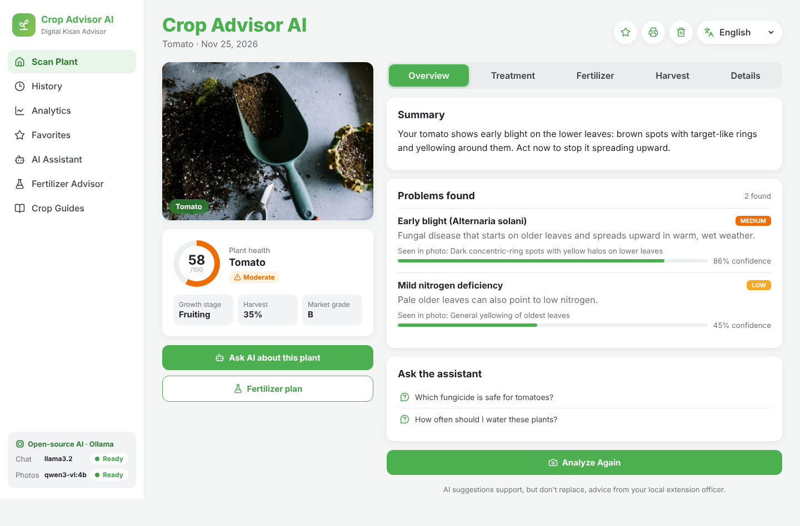

# Crop Advisor AI — AI Farming Assistant (website + system)

A farmer photographs a plant or uploads a photo. **Gemini Flash** analyses its **health**, **problems** (diseases, pests, nutrient and water issues), **growth stage**, **harvest readiness** and **market quality**, then gives treatment steps, a watering plan and a fertilizer plan. An AI assistant answers farming questions using the plant's analysis, attached photos and a built-in agricultural knowledge base.



## What's inside

```
CropAdvisor/
├── docker-compose.yml   # website + API + PostgreSQL + optional Ollama
├── .env.example
├── web/                 # the website (React + Vite) — responsive: sidebar on desktop, app-style bottom nav on phones
├── backend/             # FastAPI API: analysis, chat, fertilizer, history, analytics, guides
│   └── app/knowledge/   # crop profiles + guides the AI is grounded in
└── mobile/              # optional Expo (React Native) phone app using the same API
```

| Page | What it does |
|---|---|
| **Scan Plant** | Take or drop a photo, pick the crop, describe what you see → AI analysis |
| **Analysis** | Health score, problems with confidence, Overview · Treatment · Fertilizer · Harvest · Details, print/save as PDF |
| **AI Assistant** | Chat about any scan (or general questions), attach photos, Tools · Guides · Scan, answers cite the guides used |
| **Fertilizer Advisor** | Product, NPK ratio, how/when to apply, full season schedule by growth stage |
| **History / Favorites** | Search and filter every scan, star the ones to watch |
| **Analytics** | Scans, average health, healthy plants, ready to harvest, trend, problems by frequency |
| **Crop Guides** | The knowledge base the AI uses |

Language picker: English, Afrikaans, isiZulu, isiXhosa, Sesotho, Kiswahili, Hindi, French, Portuguese, Spanish.

## The AI (Gemini Flash by default)

The default provider is Google's hosted **Gemini Flash** (`gemini-flash-latest`) for faster chat and photo analysis than CPU-only local models. You need a Gemini API key. Requests, including plant photos, are sent to Google's Gemini API; Google's quotas and pricing apply.

| Job | Model | Size | Notes |
|---|---|---|---|
| AI Assistant (chat) | `gemini-flash-latest` | Hosted | Requires `GEMINI_API_KEY` |
| Photo analysis | `gemini-flash-latest` | Hosted | Photos are sent to Google's API |

- **Keep the API key private:** put a newly created key in `.env` as `GEMINI_API_KEY=...`; never put it in source code or commit it.
- **Local alternative:** set `AI_PROVIDER=ollama` and start with `docker compose --profile ollama up -d`. Local CPU inference can be much slower; an NVIDIA GPU can help.
- **No key configured:** the app explains that setup is needed and falls back to its built-in farming knowledge base.

## Run it — Docker (recommended)

```bash
cp .env.example .env
# Add GEMINI_API_KEY to .env before starting the app.
docker compose up -d --build
```

Open **http://localhost:8080**. API docs are at http://localhost:8000/docs.

**Already running the Dietitian AI API's Ollama?** Set `OLLAMA_BASE_URL` in `.env` to that server (for example `http://host.docker.internal:11434`) and remove the `ollama` service from `docker-compose.yml`. Both apps then share the models.

## Run it in VS Code without Docker

1. Install [Ollama](https://ollama.com/download), Python 3.12+ and Node 20+. Then open the folder in VS Code.
2. `Ctrl+Shift+P` → **Tasks: Run Task** → **AI: download models into Ollama**.
3. Run the task **Backend: install Python deps**, then press **F5**. The API starts on port 8000 with SQLite.
4. Run the tasks **Website: npm install** and **Website: start dev server**, then open http://localhost:5173.

## API

| Method | Path | Purpose |
|---|---|---|
| GET | `/health` | Server and AI model status |
| POST | `/api/ai/recheck` | Look for the models again |
| POST | `/api/analyze` | multipart `image` + optional `crop`, `notes`, `lang` → analysis |
| GET | `/api/analyses[?favorite=true]` | History / favourites |
| GET / DELETE | `/api/analyses/{id}` | One analysis |
| PATCH | `/api/analyses/{id}/favorite` | `{ "favorite": true }` |
| POST | `/api/chat` | `{ messages, analysis_id?, image_base64?, lang }` |
| POST | `/api/fertilizer` | `{ crop?, stage?, analysis_id? }` |
| GET | `/api/guides`, `/api/guides/{id}`, `/api/crops`, `/api/stats` | Knowledge base and analytics |

Each browser gets an anonymous ID, so history is per device. Add user accounts and HTTPS before putting the site on the public internet.

## Tests

```bash
cd backend && python -m pytest -q    # Gemini and Ollama request/response tests use mock servers
cd web && npm run build && npm run lint
```

The farming guidance in `backend/app/knowledge/` is general agronomy. Have a local agronomist or extension officer review it for your crops, climate and registered products before farmers rely on it.
